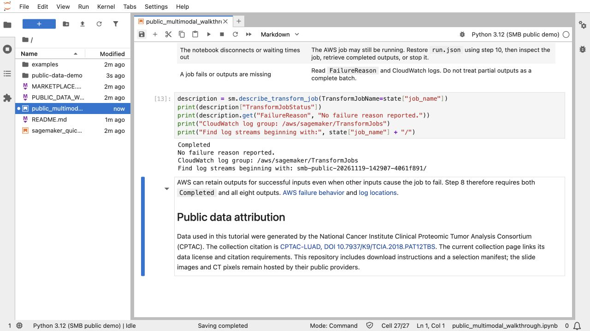

# Verified notebook execution

On November 19, 2026, we opened the ready notebook in JupyterLab and chose
**Run > Run All Cells** once. All 13 code cells completed in order, including
installation, public downloads, input preparation, one AWS batch job with eight
requests, response verification, numerical comparison, and cleanup.

Use the [ready notebook](../../../public_multimodal_walkthrough.ipynb) from the
repository root for your own run. The [executed notebook](executed.ipynb) here
is the unchanged evidence copy with its saved outputs. It retains the
explanatory text and relative links from the repository root at test time.
Later documentation updates describe the completed test; the executable cells
are identical. Their hashes are in [run.json](run.json).

## What was tested

- A fresh repository copy and new Python 3.12.0 virtual environment on macOS
  arm64, with JupyterLab 4.6.6 and ipykernel 7.4.0.
- No data packages or public asset cache before running the notebook.
  [Before execution](before-notebook.json) and
  [bootstrap packages](bootstrap-packages.json) record that starting state.
- The documented kernel and four AWS configuration environment variables,
  using the account's existing subscription, role, bucket, and quota.
- Fresh downloads of the clinical CSV, two whole-slide images, two CT ZIPs,
  and the PathDB slide records. The two public GDC metadata snapshots came
  from the repository and passed their checksum checks.
- Patient and specimen matching, slide day zero, CT days -1 and -109,
  both readable slides, and all 140 CT pixel arrays.
- Eight new request UUIDs, eight valid responses, and exact numerical agreement
  with the [earlier AWS run](../reference-run/README.md).
- Removal of the temporary model and all objects under this run's S3 prefix,
  verified again through separate AWS read calls. The local Jupyter server
  and kernel were stopped after saving the evidence.

The first fresh attempt stopped before AWS submission because the live GDC
hostname failed to resolve. We added the recorded public metadata with source
URLs and hashes, then repeated the test in another new environment with an
empty cache. This directory records that complete successful run. The original
Markdown walkthrough had previously been tested by extracting Python blocks;
this test used the actual notebook UI without extracting or editing cells.

## Actual results

The job `smb-public-20261119-142907-4061f891` used one `ml.g5.2xlarge` in
`us-east-1` with network isolation. Creation to completion took 482.871 seconds.
All eight scores matched the earlier run exactly at the returned precision.

| Patient | `ehr` | `ehr-wsi` | `ehr-ct` | `ehr-wsi-ct` |
|---|---:|---:|---:|---:|
| `C3L-00263` | 291.09576153 | 271.37754702 | 296.24379776 | 260.38882875 |
| `C3L-00422` | 272.53007848 | 277.64935748 | 345.72121953 | 319.67090811 |

The table is rounded. [predictions.csv](predictions.csv) contains full precision
scores and request UUIDs. [request-index.json](request-index.json) records each
request, TAR checksum, and patient input fingerprint.
[verification.json](verification.json) records the patient and date evidence.
[cleanup.json](cleanup.json) is the notebook's cleanup result;
[run.json](run.json) also records the independent cleanup checks.

The following JSON files were parsed from S3 and saved with indentation by
the notebook. Their field values are the actual AWS responses. Their formatting
is not the original S3 byte formatting. File hashes are in `run.json`.

- [C3L-00263, ehr](responses/C3L-00263-ehr-os.tar.out).
- [C3L-00263, ehr-wsi](responses/C3L-00263-ehr-wsi-os.tar.out).
- [C3L-00263, ehr-ct](responses/C3L-00263-ehr-ct-os.tar.out).
- [C3L-00263, ehr-wsi-ct](responses/C3L-00263-ehr-wsi-ct-os.tar.out).
- [C3L-00422, ehr](responses/C3L-00422-ehr-os.tar.out).
- [C3L-00422, ehr-wsi](responses/C3L-00422-ehr-wsi-os.tar.out).
- [C3L-00422, ehr-ct](responses/C3L-00422-ehr-ct-os.tar.out).
- [C3L-00422, ehr-wsi-ct](responses/C3L-00422-ehr-wsi-ct-os.tar.out).

